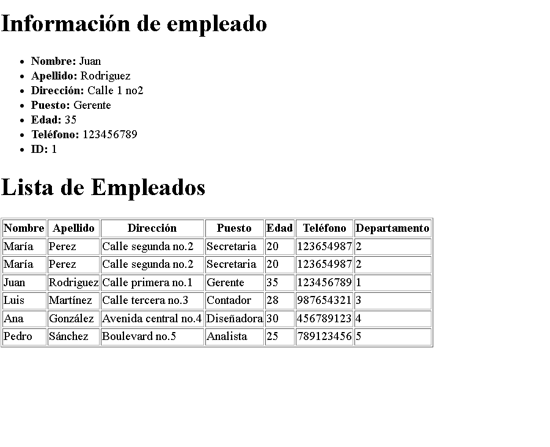
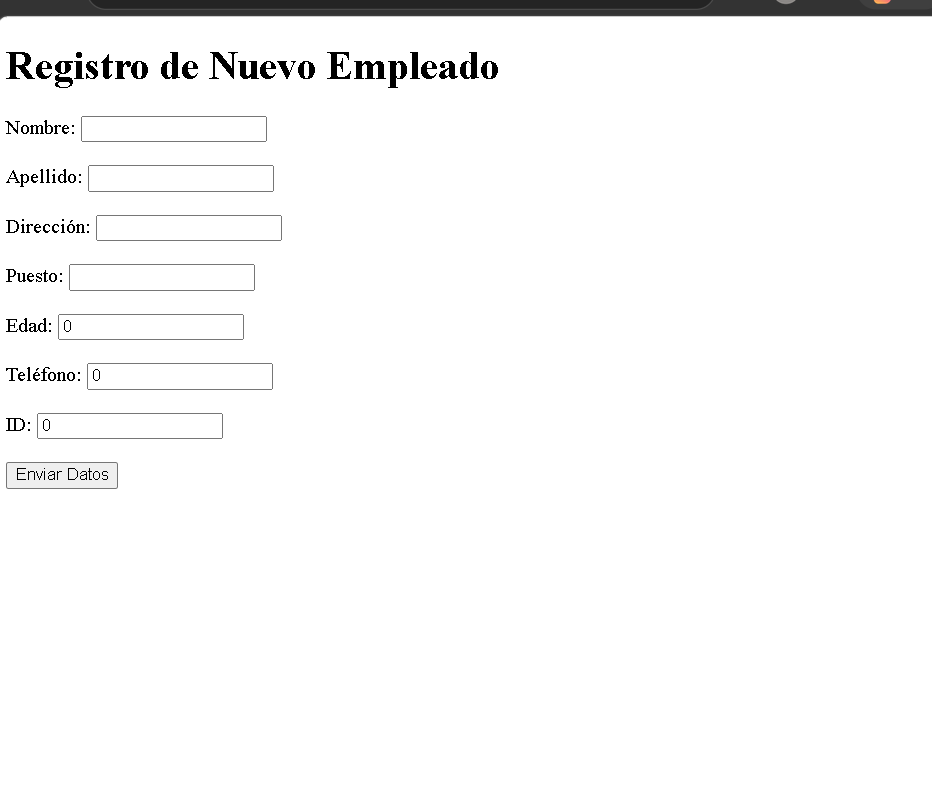
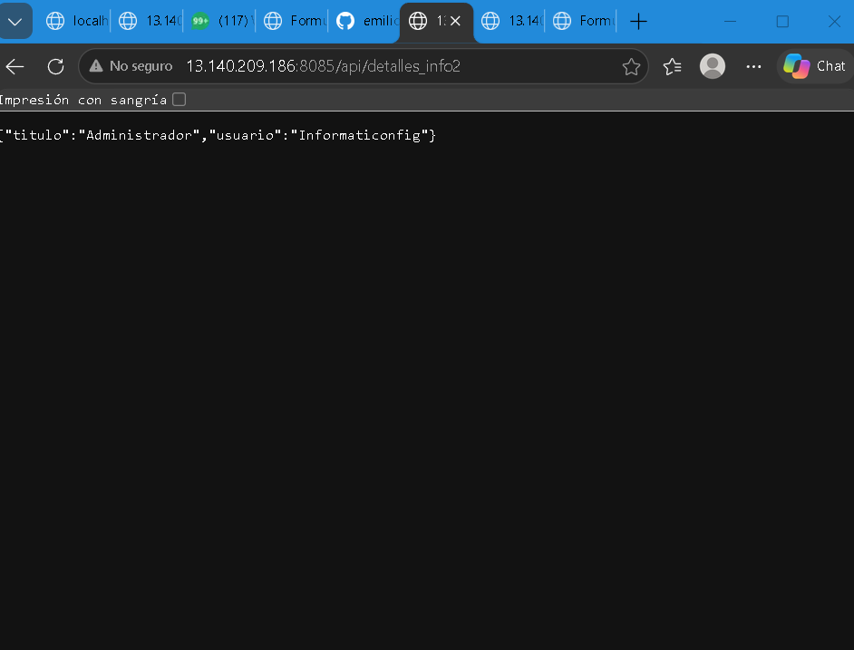
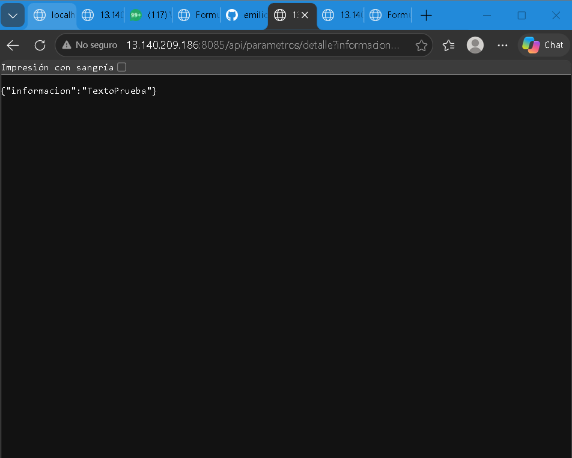
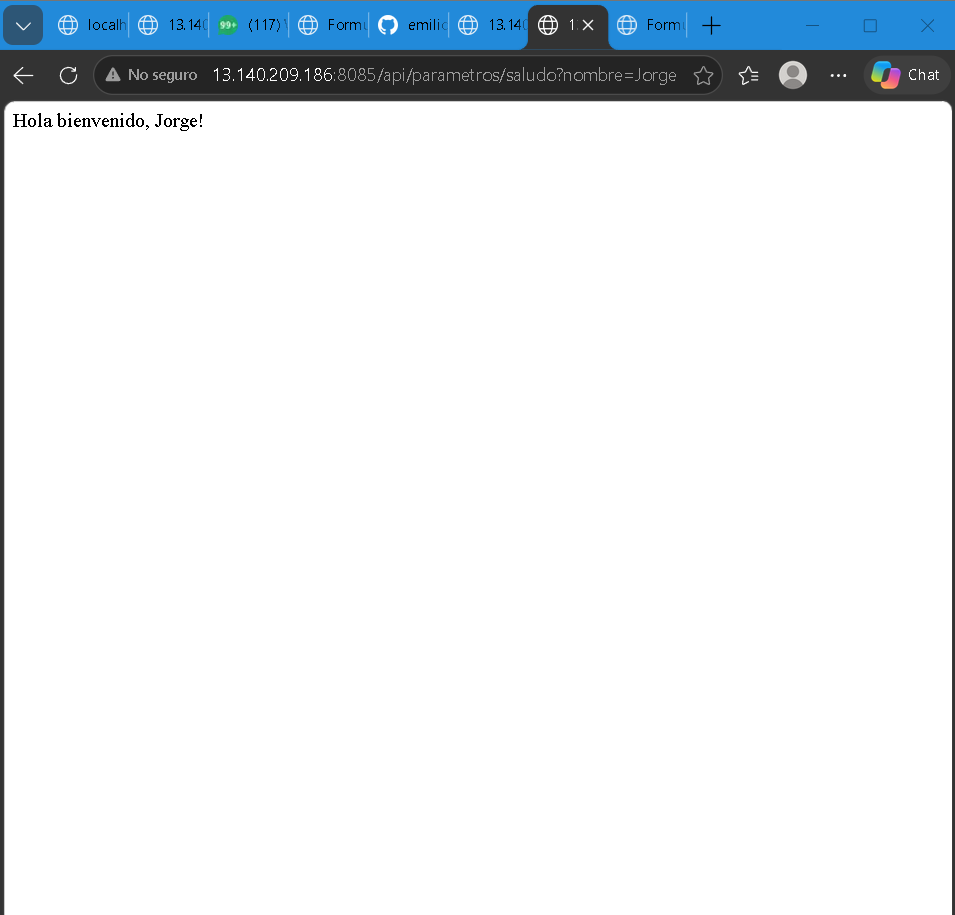
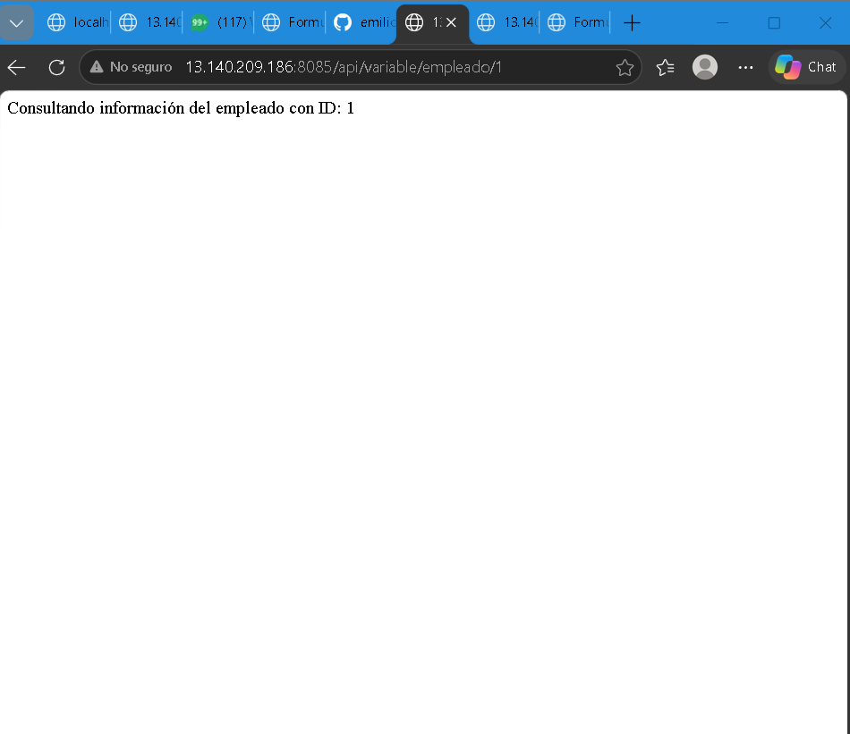
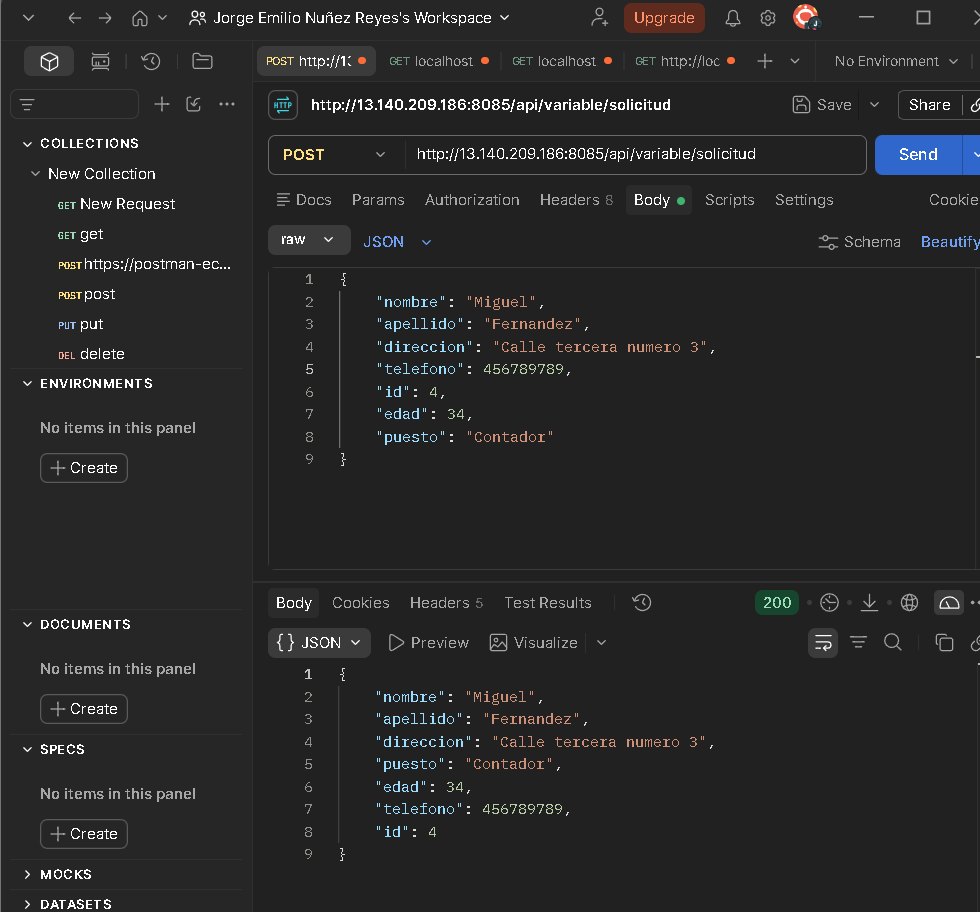

# Aplicación Spring Boot 
Nunez Reyes Jorge Emilio

## 🛠️ Endpoints y Vistas del Proyecto (VPS)

### 1. Vistas Thymeleaf (MVC)
- **Lista de Empleados (`th:each`):** `http://13.140.209.186:8085/detalles_info`

- **Formulario de Registro (`@ModelAttribute`):** `http://13.140.209.186:8085/form` *(Envía datos por POST a `/guardar`)*

### 2. Endpoints REST (JSON)
- **DTO:** `http://13.140.209.186:8085/api/detalles_info2`

- **Query Parameters (`@RequestParam`):**
  * Detalle: `http://13.140.209.186:8085/api/parametros/detalle?informacion=TextoPrueba`
  
  * Saludo: `http://13.140.209.186:8085/api/parametros/saludo?nombre=Jorge`
  
- **Path Variables (`@PathVariable`):**
  * Mensaje: `http://13.140.209.186:8085/api/variable/pagina1/MiMensaje`
  
  * ID Empleado: `http://13.140.209.186:8085/api/variable/empleado/1`
  
- **Propiedades personalizadas (`@Value`):** `http://13.140.209.186:8085/api/variable/valores`

- **Petición POST (`@RequestBody`):** `http://13.140.209.186:8085/api/variable/solicitud` *(Probar en Postman/Bruno enviando un JSON de Empleado)*

- **Instancia Activa:** `http://13.140.209.186:8085/mi-instancia`